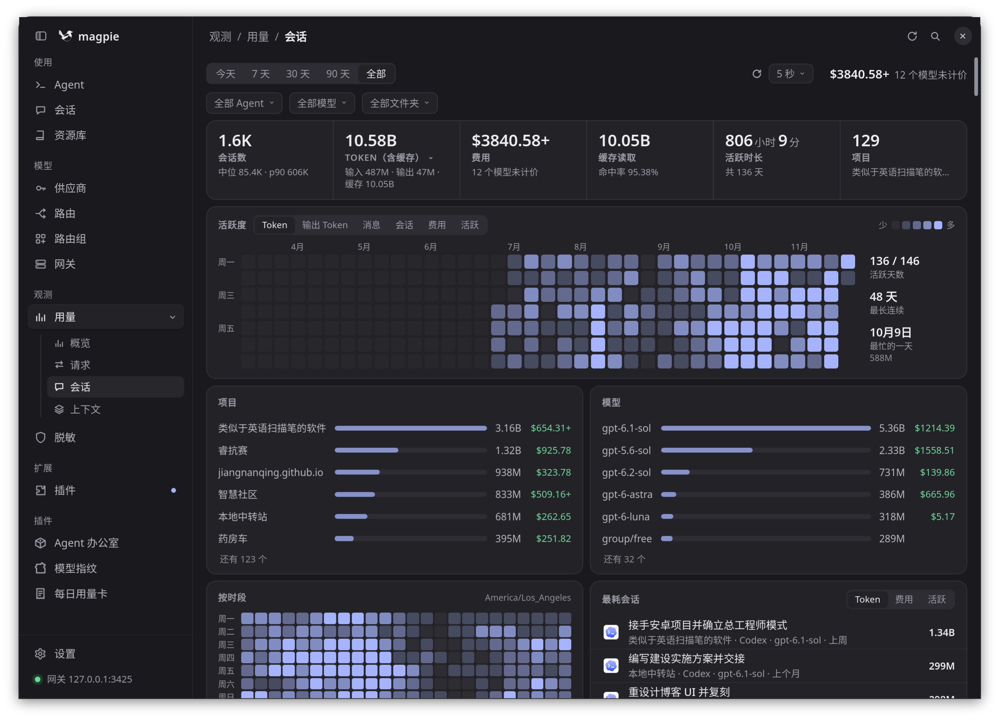
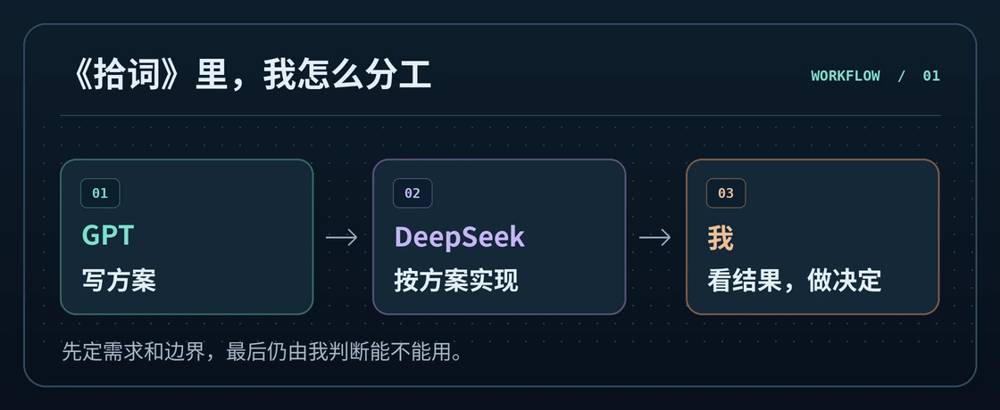
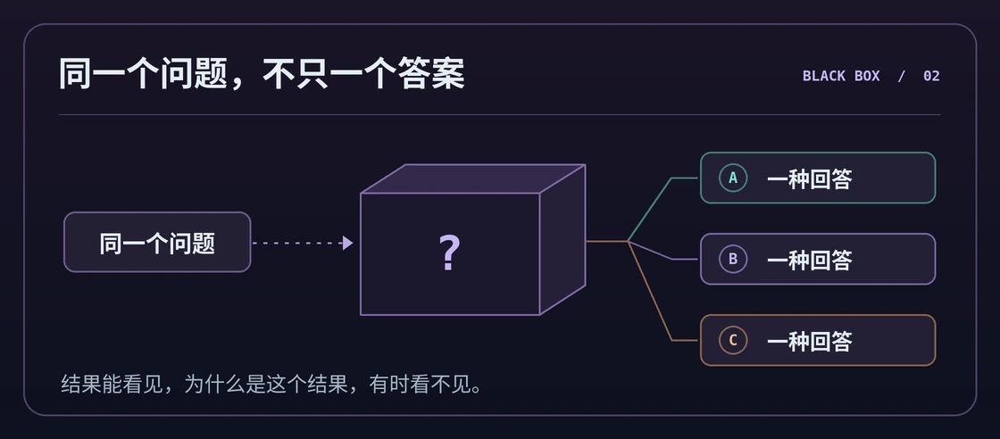

书接上回。[7 月 24 日发那篇帖子](/2026/07/24/AI使用感受/)的时候，我刚用 AI 辅助完成机器人比赛。实话讲，当时感觉自己接触到了 AI 的前沿，觉得很震撼。

但我依旧认为，得有人，AI 才能发挥最大的作用。对吧，你不能说一句「帮我做一个翻译软件」，就指望 AI 完完全全给你搓一个好用的软件出来，不现实。前端、后端这些都不懂，你凭什么知道它做出来的东西好不好用？直到 2026 年 11 月 24 日，我依旧这么认为。但是，这几个月给了我一些不一样的认识。

<!-- more -->

先放一张图，证明我确实算个重度用户。就算不是重度，也算是中度，并且忠于 ChatGPT。

## 先讲讲这几个月的模型

从 8 月说起。国产模型里，GLM、Kimi、DeepSeek 都发展得不错，混元也是，MiniMax 也是，甚至出了平价的视频模型。Qwen 在小模型上也很厉害。

国产模型里我用得多的只有 DeepSeek，其他的我都是看别人在用，我不做评价。单说 DeepSeek，这几个月我印象最深的还是 Flash。有人会说不就是蒸馏出来的吗？比如 [V4.1 Flash](https://huggingface.co/deepseek-ai/DeepSeek-V4.1-Flash)，它是从头预训练，再在后训练里用蒸馏，不是把 Pro 直接压小。就算用了蒸馏，能把模型做得又便宜又好用，我也觉得是进步。实话讲，我通过 Magpie 用 DeepSeek 的那段时间，额度我用不完。好用，便宜，这就是优点。

再说一说国外的，Claude、ChatGPT、Grok、Gemini。

**Claude。** [Fable 5 在 7 月重新开放](https://www.anthropic.com/news/redeploying-fable-5)，8 月底又出了 Fable 5.1。我记得那阵子大家聊 Fable，挺沸腾的，因为都见识过它的能力。看别人跑出来的结果，有些活儿确实比 GPT 做得强。

（我没有沸腾，我没有账号用。）

**ChatGPT。** 我一直用的模型。实话讲，看她干活像是在看另一个我自己干活，有过之而无不及。太严谨了，我很喜欢，到现在还是我最喜欢的模型，没有之一。

但有三个问题。第一个，看别人用 Claude，有些事 GPT 确实比不过。我看不惯 Dario 那个嘴脸，我希望 OpenAI 赢，超过 Claude。第二个，太慢了，而且不说人话。我真的很难接受，每次都要再问一遍到底做了什么。

第三个，这模型为什么要校验那么久？我不理解。一个小脚本，为什么要校验四十多分钟？先给我，我自己跑一遍看看效果就知道了，结果还是在那儿校验。**一个小问题，为什么要当一个核弹发射井去做？**

虽然有过一段时间，Astra 给我的感觉是超过了 Claude，但是我不得不说，太贵了，也慢。我还是喜欢 Sol，没什么别的，就是感觉。

**Grok：已找到片。** 4.7 确实惊艳了一段时间，不过后来在我这儿还是让 Claude 和 GPT 当路边一条踢死了。那句「应该放慢 AI 的发展速度」，感觉只有 Musk 听进去了。

**Gemini，哈基米。** 11 月之前，我自己用得上的基本只有 Flash。本来以为以后也就用 Flash 了，结果人家照着元素周期表去发模型了，突然一波大的。我觉得 Gemini 已经追上来了，未来可期。

## 再来看看工具

到 11 月 24 日为止，至少在我平时做的事里，我觉得模型的能力已经没什么大问题了。再来看看工具。

- **Codex**，我最喜欢的 CLI，没有之一，简洁，好用。ChatGPT 桌面端也好用，远程功能一开始觉得惊艳，中间断联了几次，给我整得挺恶心的，希望优化一下。
- **Claude Code**，我一直拿来跑 DeepSeek，没用过别的模型。其实我最早也是在 Claude Code 上用 DeepSeek 的。
- **ZCode**，仓库数据上传那事，不讲。
- **Pi 和 OMP**。Pi 太简洁了，不想折腾。OMP 给我的感觉就是 Claude Code，我真心这么觉得，很好用，很喜欢，现在也是用来跑 DeepSeek 的。
- **DeepSeek Harness**，插件系统很惊艳，类似于 MC 的 Mod 系统，真的很好。但我用的是 Ubuntu，有时候莫名其妙就崩溃了，我不理解为什么。尽快优化一下吧。
- **AGY CLI：请输入文本。**

## 再讲讲我怎么用 AI

**Prompt Engineering**，最常用的方式，一问一答，做点小脚本一点儿问题都没有。但是我觉得效率不够高，你遇见 ChatGPT 这个速度的模型，你不爆炸了吗？但实话讲，我确实用得最多。尤其是项目刚开始，方案怎么定，`AGENTS.md` 里具体写什么，基本都是这样聊出来的。

**Loop Engineering 和 Goal Engineering**，放在一起说。我就按我自己的用法讲。我觉得这俩有很多地方是一样的，都是让 AI 自己查、自己改，区别是项目接下来该做什么，由谁决定。一个 Goal 要是一轮就结束，我用起来觉得跟 Loop 没什么区别。一个 Goal 很长的时候，就不一样了。

我们假定都是做一个博客网站。按我用 Loop 的习惯，我知道最后想要什么样子，然后让 AI 一个模块一个模块去做。做完导航，看了结果再决定下一步做什么，这个决定是我来做的。Goal 不是，我先说清楚要做哪些模块、做成什么样算完成，具体先做哪个、哪里不合适，让 AI 在这个范围里自己把握。

这是我用下来的感受。`AGENTS.md` 足够清楚，我自己也知道怎么验收的时候，我觉得 Goal 更高效。如果没那么清楚，我还是建议用 Loop 来做。

**Graph Engineering**，我现在叫它「总工程师模式」。还是先定好 `AGENTS.md`，然后让不同的模型做不同的事。GPT 写方案，DeepSeek 执行。我提需求，最后看做出来的东西能不能用。不多说，我的软件《拾词》就用的这种模式，很高效。

以上就是我这几个月对 AI 发展的观察。今年发展得太快了，我都怀疑，明年是不是就有 AGI 了？我觉得有可能，但我希望不是，因为我还要吃饭，我不希望 AI 取代我。

## 用下来的感受：多、快、好、省

不说这个，说下感受。多、快、好、省。

**多。** AI 模型数量太多了，不存在一家独大，也不存在一无是处的 AI。我现在觉得最好用的还是 Graph 这种分工方式，按需要买不同的订阅，各自扬长避短。除了模型，还有 Harness，也太多了，每家公司有自己的，个人开发者也在做，比如 Pi。我觉得不用全装，选三五个就够了，最好是原生的，功能尽量全。最后是 AI 的配置，早期我用过 CC Switch，后来也用过 Magpie。萝卜白菜，各有所爱，我觉得都挺好用。Magpie 还能薅羊毛，看个人需求。

**快。** 我见过每秒十来个 token 的，也见过三百多个的。并且 AI 能更好地理解需求了，不怎么返工，处理工作的速度也就变快了。

**好。** 这个不用多解释。代码好，速度好，质量好。

**省。** 那确实。我有时候不理解，为什么模型能力强了，价格还能更低。不过，省！

## 还有，为什么我反而更累了？

除了这些，用了 AI 以后，我感觉自己更累了。以前想学原理，现在更想学怎么使用 AI。因为有些原理，我问它，它基本都知道。我就觉得，我学了好像也没多大用。但还是那句话，你不学原理，凭什么知道方向对不对？所以原理也得学。累就累在这里，什么都得学，比原来要学的还多。

有了 AI，效率高了，被分到的事和自己想做的事也多了，精力就更分散。一要做事，一看这么多，心累。真做起来，身体也累。

然后就是黑盒。我改一点提示词或者调个参数，有时候结果就变了。到底哪句话、哪个参数起了作用？不知道。有时候跟抽卡一样，抽到对的就继续，抽不到就重新抽。

还有就是，学习的欲望真的减退了，总觉得有 AI 就能解决一切，但并不是。总之，AI 给了我效率，也给了我心累和恐惧。

## 最后，畅想一下

对我来说，AI 用起来确实是多快好省。但是，这么快的发展真的是对人类社会有好处的吗？我觉得不一定。就说失业吧，假如一个人能用 AI 处理以前五个人的工作，那另外四个人呢？不一定是现在就裁掉，也可能是以后不招了。我担心就业岗位会变少，赚到钱的更多是 AI 公司和会用 AI 的人。未来真不见得对所有人都是好的。

还有数学问题。我看到 OpenAI 的模型能[给一个关于平面单位距离的猜想找到反例](https://openai.com/index/model-disproves-discrete-geometry-conjecture/)。有些问题，人想了很久都没解出来，AI 却能给出以前没人想到的结果。那所有事情还是可控的吗？我不知道。

以前我觉得 AI 就是个玩具，或者一个助手，帮人解决一些重复的事情，帮人理解一些概念。现在我很难想象，由人训练出来的一堆程序，为什么就能解开困惑人类许久的问题。我不知道它到底见过哪些数据。本来以为就是在学过的东西上做点发散，结果有些东西已经超出了我原来对「发散」的理解。这个黑盒到底怎么回事？为什么？凭什么？

最后畅想一下。或许明年，或许后年，又或许是未来的某一天，不知道。但我觉得总有那么一天，AGI 要到来，我们的生产力能不能跟上，我也不知道。究竟是用 AI 加快生产力的发展，还是反过来被 AI 取代，连经济都崩了？不清楚，我希望是前者。

要是跟上了，我希望那个时候已经实现了共产主义，人都能为自己而活。
